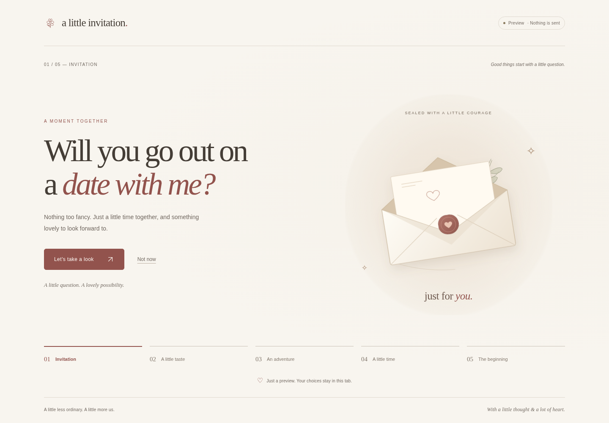
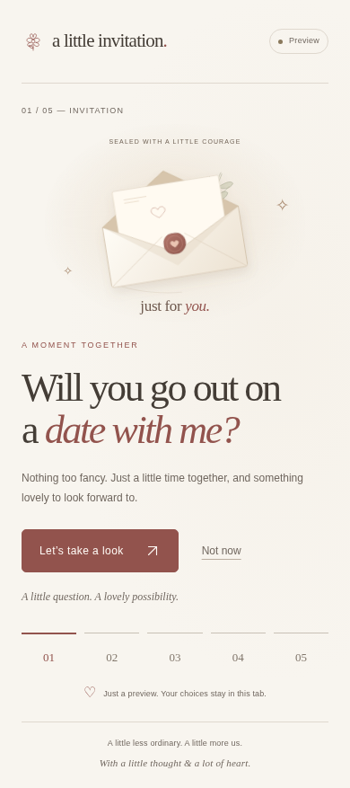

# Phase 1 review

Completed for review on 2026-10-25 (Asia/Singapore). Product scheduling remains Asia/Manila. Base: latest merged `main`, `dc4b1ebfc1c53b72d2420186acb5a680644b8286`; review branch: `codex/phase1-foundation`.

## Completed scope

- Semantic HTML entry point and a responsive off-white design with serif headings, a muted rose accent, clear focus states, original local envelope/flower SVGs, and system fonts.
- Tailwind/CLI 4.3.3 compiled in Codex Cloud into static CSS, with exact dependency versions and a lockfile. No browser CDN compiler or runtime framework.
- Five working placeholder stages: invitation, dinner preview, activity preview, scheduler preview, and a clearly labeled preview ending. A stable “Not now” exit is also available.
- Centralized in-memory state; forward/back navigation; same-tab browser history; focus/announcements; visited-stage navigation; refresh/reset clears the draft. A sample preference survives navigation and can be changed.
- Configurable dinner inclusion and unresolved client values. Final Yes/Yes versus Yes/No behavior is not invented; the neutral “Let’s take a look” button explores the preview only.
- Mock-only transport boundary. A result is always `{mode: 'mock', sent: false}`. The ending never claims real delivery. Real answer fields stay unset, and no actual activity/date/time is collected yet.
- Local preview server, automated checks, actual browser screenshots, and a standalone HTML review copy containing all CSS, scripts, and artwork.

No final activity cards/image catalog, live date/time selector, approved dinner categories, moving-button prank, Animate.css, floating hearts, music, confetti, provider integration, public hosting, notifications, or deployment workflow was added. These remain later-phase work.

## How to preview

**Browser only:** On the review branch or pull request, open `docs/preview.html`, choose **View file** if starting in the diff, then **Download raw file**. Open that downloaded HTML in your browser. No installation, account, server, or API key is needed. It is the same mock foundation packaged as one file; it does not send anything.

The managed cloud browser blocks `file://` navigation. The standalone document was therefore served as one local HTTP document and exercised after disconnecting the browser's network. Its whole journey passed with zero additional HTTP requests and no runtime errors. Direct opening on the café computer is a remaining manual check, not something falsely claimed as tested here.

**Cloud development:** `npm ci --ignore-scripts`, `npm run build`, then `npm run dev` starts a loopback-only server at `http://127.0.0.1:4173/Date-invitation/`. That address exists inside the cloud workspace, not on the café machine. A client-provided port-preview control may open 4173; no such user-facing opening tool was available in this session. No public preview URL was created.

After editing source, run `npm run build` and `npm run preview:export` to refresh the compiled CSS and single-file copy. See README.md for test/tooling instructions.

## Actual screenshots

These are full-page captures from the rendered application, not design mockups or generated images. Desktop: Chromium viewport 1440 × 1000. Mobile: Chromium touch/mobile emulation at 390 × 844; the full page is taller than the viewport. No private/reference screenshots are included.

| Capture | Image size | File |
| --- | --- | --- |
| Desktop invitation | 1440 × 1000 | [desktop.png](docs/previews/desktop.png) |
| Mobile invitation | 390 × 877 | [mobile.png](docs/previews/mobile.png) |
| Mobile sample preference | 390 × 958 | [mobile-sample.png](docs/previews/mobile-sample.png) |

## Checks executed

| Check | Result |
| --- | --- |
| `npm ci --ignore-scripts` | Passed: clean locked installation in cloud |
| `npm run build` | Passed: compiled Tailwind CSS, no Play CDN |
| Clean build/export reproducibility | Passed: SHA-256 identical for compiled CSS and standalone review HTML before/after clean installation and rebuild |
| `npm test` | Passed: 8 Node tests |
| `npm run test:browser` | Passed: 10 Python/Playwright/browser checks, using Chromium 154.0.8037.57 |
| Browser errors/assets/network | No runtime errors, no missing site resources, no external requests during tested flows |
| `git diff --check` | Passed before review commit |
| Source/privacy review | No key, live endpoint, real response, recipient identity/email, raw attachment, or private conversation included |

The Node tests cover sample retention without converting it into a real answer, invalid/unreached choices, omitted dinner, mock-only ending, respectful decline, reset, immutable snapshots, and network-free mock handling.

Browser checks cover the full journey, app/browser Back and Forward, focus, sample retention, refresh/direct-hash reset, keyboard skip/exit, repeated events, omitted-dinner configuration, JavaScript-disabled fallback, no horizontal overflow at 320/390/768/1440 widths across all stages, reduced motion, Chromium CSS 200% zoom/reflow, actual screenshots, disconnected standalone preview, and server restrictions against repository-private files. This is desktop browser emulation, not real-device certification.

Two issues were corrected during verification: unsupported arrow glyphs were replaced with local SVG icons; the JavaScript-disabled/loading-failure message now remains visible until the app actually initializes. Text/select colors were adjusted after contrast calculations. All applicable checks passed after fixes.

## Accessibility, performance, and privacy evidence

Inactive stages use native `hidden` and cannot receive normal tab focus. Stage headings receive focus after navigation; stage changes are announced politely. The sample select has a label/help text. Progress controls have descriptive accessible names even when mobile displays only their numbers. Reduced motion removes transition/entry animation. The exit stays stable and usable.

Calculated color pairs: primary text 9.81:1; muted text 5.09:1; primary button text 5.68:1; decorative label 4.65:1; illustration caption 5.18:1; select border 3.66:1. These calculations and keyboard/DOM checks are not a full screen-reader or WCAG conformance audit.

Initial public HTML+CSS+JavaScript+SVG files total **37,349 bytes uncompressed**, within the provisional 100 KiB budget. CSS: 14,895 bytes (budget 30 KiB); JavaScript: 9,239 bytes (budget 20 KiB). The standalone review copy is 41,774 bytes and is loaded separately. No external fonts, media, tracking, browser CSS compiler, or runtime framework is needed. PNG review captures are documentation assets, not loaded by the site.

No localStorage/sessionStorage, cookie-based drafts, real answer persistence, or personal data collection was added. The local preview server and standalone artifact forbid outgoing connections/form actions through a content-security policy. The app contains no live submission implementation, endpoint, or key. These controls do not establish future backend security; no backend exists yet.

## Review limits and next task

Tailwind's documented provisional browser baseline is Chrome 111+, Safari 16.4+, and Firefox 128+. Only system Chromium was exercised; real mobile Chrome/Safari, Firefox/WebKit, physical-device performance, a full screen-reader audit, and direct downloaded-file opening remain unverified. No live service or deployment test was attempted.

Q01–Q03 (final invitation behavior, dinner inclusion/options, and progression) need client decisions before Phase 2 final interactions. Time availability, answer retrieval/email acceptance, personalization, media, and repeat/revision policy remain open for their later phases. Phase 1 engineering defaults are not approval of those product choices.

Review the actual screenshots and click through the single-file preview. After accepting Phase 1, resolve Q01–Q03 and explicitly authorize Phase 2. No automatic merge, later-phase implementation, live notification, or public deployment is authorized by this review.
